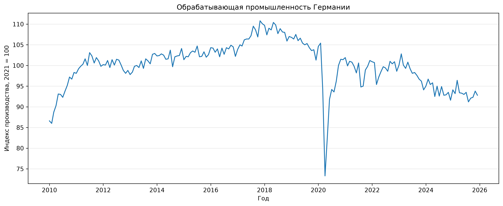
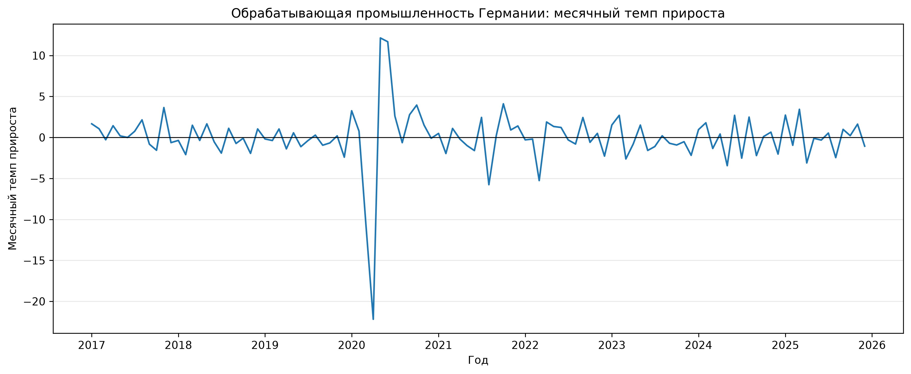
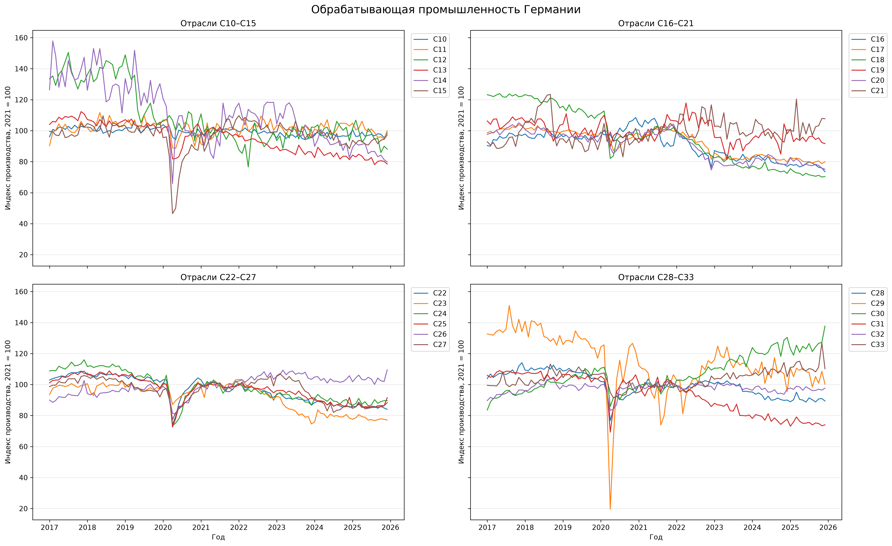
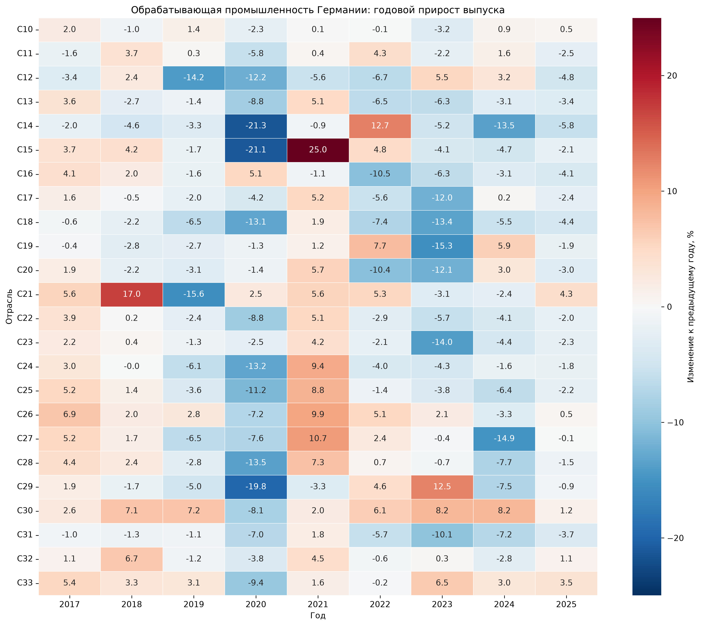
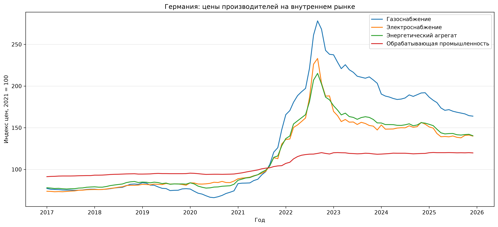
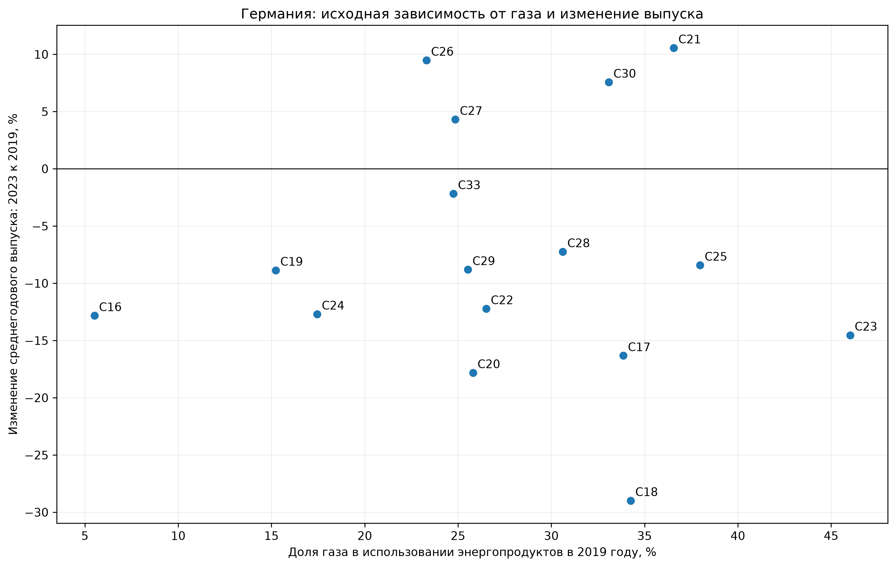

# Энергетические цены и промышленный выпуск в Германии

Пилотный анализ данных Завгородний Валентин

**Исследовательский вопрос:** почему подорожание энергии сопровождается разными потерями выпуска в разных отраслях и какую роль играют замещение ресурсов и перестройка технологий?

## Что собрано

| Блок | Фактическое покрытие | Использование |
|---|---|---|
| Промышленный выпуск | Германия, C10–C33, январь 2010 — декабрь 2025; 4 608 заполненных отраслевых наблюдений; дополнительно агрегаты C и D | Индекс объёма производства и его динамика |
| Цены производителей | Германия, C10–C33, C, D351, D352 и MIG_NRG; 28 рядов × 192 месяца = 5 376 наблюдений | Отпускные цены промышленной продукции и энергетики |
| Физические энергетические счета PEFA | Германия, C16–C30 и C33; 2010–2023; P00, P13 и P26; 672 наблюдения | Исходная структура использования энергопродуктов |
| Итоговая месячная панель | **16 отраслей × 192 месяца = 3 072 строки**, 14 столбцов | Совместный описательный анализ |

В проверенных исходных срезах нет дубликатов по ключам наблюдений. После объединения нет пропусков в присоединённых долях и трёх ценовых индексах. Обычные начальные пропуски у MoM/YoY сохраняются: для первого месяца или первых 12 месяцев нет предшествующего наблюдения для расчёта.

### Основные источники

1. [Eurostat — Production in industry, monthly data (`sts_inpr_m`)](https://ec.europa.eu/eurostat/databrowser/view/sts_inpr_m/default/table?lang=en). Фильтры: `DE`, `M`, `PRD`, `SCA`, `I21`.
2. [Eurostat — Producer prices in industry, domestic market (`sts_inppd_m`)](https://ec.europa.eu/eurostat/databrowser/view/sts_inppd_m/default/table?lang=en). Фильтры: `DE`, `M`, `PRC_PRR_DOM`, `NSA`, `I21`.
3. [Eurostat — Energy supply and use by NACE Rev. 2 activity (`env_ac_pefasu`)](https://ec.europa.eu/eurostat/databrowser/view/env_ac_pefasu/default/table?lang=en). Фильтры: `DE`, `A`, `USE_END`, `TJ`; `P00`, `P13`, `P26`.

Полный реестр использованных, проверенных и потенциальных источников с ограничениями находится в [data/source.csv](data/source.csv). Статус «резерв» означает, что источник **не включён** в расчёты этого пилота.

## Что означают показатели

**Индекс выпуска, 2021 = 100** показывает объём производства относительно собственного базового уровня отрасли.

**Индекс цен производителей** отражает отпускные цены продукции соответствующего сектора на внутреннем рынке. `D352` характеризует цены газоснабжения, `D351` — электроснабжения, `C20` — продаваемой химической продукции. Энергетические PPI не являются индивидуальными закупочными ценами газа и электричества для каждой отрасли и не подменяют котировки TTF.

В PEFA `P00` обозначает все энергопродукты, `P13` — природный газ без биогаза, `P26` — электричество. Объёмы выражены в тераджоулях. Поток `USE_END` включает и энергетическое применение, и использование ресурсов как сырья. Поэтому доли ниже относятся к физической структуре использования энергопродуктов, а не к долям расходов или способности заменить топливо. Подробнее: [метаданные PEFA](https://ec.europa.eu/eurostat/cache/metadata/en/env_pefa_sims.htm), [руководство, раздел 4.5.1](https://ec.europa.eu/eurostat/documents/1798247/6191537/PEFA-Manual-2014-v20140515.pdf).

## Подготовка и объединение

1. Проверены страна, частота, единицы, корректировка, периоды и отраслевые коды.
2. Удалены пустые служебные поля из рабочих таблиц; исходные CSV сохранены отдельно.
3. В выпуске исключены полностью пустые ряды D351/D352. Отсутствующий D353 зафиксирован в проверках. Это не препятствует использованию заполненных **ценовых** рядов D351/D352.
4. Даты приведены к месячным меткам, наблюдения отсортированы внутри отраслей. Рассчитаны MoM и YoY.
5. Для годовых сравнений использовано среднее 12 месячных индексов. Прирост между годами рассчитан из отношения этих средних.
6. PEFA развёрнут в таблицу «страна × отрасль × год». Рассчитаны доли газа и электричества. P00 уже включает обе составляющие и повторно с ними не складывается.
7. Зафиксированы доли **2019 года**. Они присоединены к месячному выпуску по стране и отрасли с проверкой `many_to_one`.
8. Отраслевые отпускные цены присоединены по стране, отрасли и месяцу (`one_to_one`). Цены газа и электричества — по стране и месяцу (`many_to_one`).

$$
g^{MoM}_{i,t}=100\left(\frac{I_{i,t}}{I_{i,t-1}}-1\right),\qquad
g^{YoY}_{i,t}=100\left(\frac{I_{i,t}}{I_{i,t-12}}-1\right).
$$

$$
s^{gas}_{i,2019}=100\frac{E^{P13}_{i,2019}}{E^{P00}_{i,2019}},\qquad
\Delta I_i=100\left(\frac{\overline I_{i,2023}}{\overline I_{i,2019}}-1\right).
$$

Доли 2019 года повторяются в месячной панели как фиксированные исходные характеристики. Это не интерполяция годового потребления и не новая месячная информация.

## Графики и предварительные наблюдения

### Общий выпуск обрабатывающей промышленности

Индекс C — официальный агрегат обрабатывающей промышленности. Видны рост в первой части периода, снижение после пика около 2017–2018 годов, резкий провал 2020 года и последующая неоднородная динамика. Снижение началось до энергетического кризиса, что важно для дальнейшего исследования.

### Месячные изменения выпуска

Показан MoM сезонно и календарно скорректированного выпуска. Нулевая линия отделяет рост от сокращения.

### Отраслевые траектории

Четыре панели по шесть отраслей, период 2017–2025, одинаковые шкалы. Группировка C10–C15, C16–C21, C22–C27, C28–C33 выполнена для читаемости. Каждая линия нормирована к собственному уровню 2021 года; сближение около базы не доказывает экономического сближения отраслей.

### Годовые приросты по отраслям

### Энергетические и промышленные цены

Подорожание энергетики начинается уже в 2021 году и усиливается в 2022-м. После пиков энергетические индексы снижаются, оставаясь выше базового уровня к концу периода. Отпускные цены обрабатывающей промышленности увеличились слабее. Различие амплитуд нельзя непосредственно трактовать как неполный перенос затрат: энергия составляет только часть издержек.

### Исходная доля газа и последующее изменение выпуска

Каждая точка — одна из 16 отраслей. По горизонтали — физическая доля газа в 2019 году; по вертикали — изменение среднегодового выпуска 2023 года относительно 2019-го.

При близких долях газа наблюдаются разные результаты. C17 и C18 имеют доли около 34%, C30 — около 33%, C21 — около 37%; выпуск первых двух снизился, а последних двух вырос. Значения изменения выпуска на графике приблизительно составляют −16%, −29%, +8% и +11% соответственно.

**Предварительный вывод:** одной исходной доли газа недостаточно для объяснения отраслевых различий. Это мотивирует изучение общей энергоёмкости, спроса, переноса издержек, структуры производства и возможностей адаптации. Диаграмма не устанавливает отсутствие или наличие причинного эффекта энергетического шока.

## Ограничения пилота

- Выборка ограничена Германией и 16 непосредственно сопоставимыми отраслями. Она не представляет все отрасли.
- 3 072 строки месячной панели не означают 3 072 независимых энергетических шока. На диаграмме рассеяния только 16 отраслевых точек.
- Физическая доля газа не равна энергетическим расходам относительно выпуска или эластичности замещения.
- Газ в PEFA может использоваться как сырьё. Счета составлены по резидентскому принципу.
- Сравнение 2019 и 2023 годов включает пандемию, отраслевые тренды и изменения спроса. Различия нельзя целиком приписать энергии.
- Индексы выпуска имеют корректировку SCA, цены — NSA. Это сохранённые определения разных источников.
- Включение C19 требует отдельного внимания: нефтепереработка одновременно использует и производит энергопродукты.

## Файлы и воспроизведение

| Файл | Содержание |
|---|---|
| `data/processed/production_monthly.csv` | Месячный выпуск, MoM и YoY |
| `data/processed/production_annual.csv` | Среднегодовые индексы C10–C33 |
| `data/processed/production_annual_growth.csv` | Годовые приросты |
| `data/processed/prices_monthly.csv` | Отраслевые и энергетические PPI |
| `data/processed/energy_annual.csv` | Использование энергопродуктов и доли по годам |
| `data/processed/energy_exposure_2019.csv` | Фиксированные доли 2019 года |
| `data/processed/panel_monthly.csv` | Объединённая панель, 3 072 × 14 |
| `data/processed/comparison_2019_2023.csv` | 16 отраслей для диаграммы рассеяния |

Используются Python, pandas, matplotlib и seaborn

